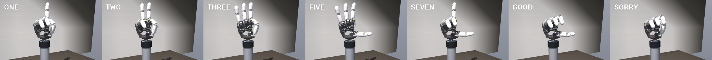
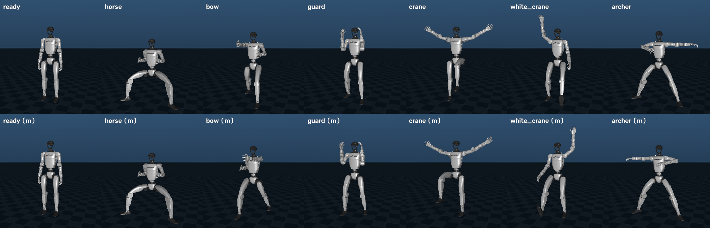
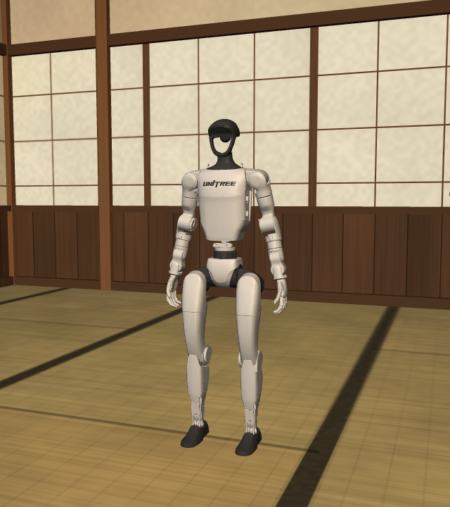

# Robot Teaches Human

In robotics the human is usually the teacher: robots learn from imitation, teleoperation and motion
capture. This project runs that pipeline backwards. A simulated robot shows you a pose, watches you
copy it through a webcam, and tells you joint by joint what to fix.

Built in one day at the Edinburgh AI Hackathon (17 October 2026) for the challenge "Flip the
Script". There are two teachers, both running in MuJoCo on one laptop:

| | Robot | Teaches | Folder |
| --- | --- | --- | --- |
| 1 | Pollen AmazingHand (4 fingers) | British Sign Language handshapes, and short statements you type | [`arm/`](arm/) |
| 2 | Unitree G1 humanoid | Martial arts stances, limb by limb | [`unitree/`](unitree/) |





Webcam frames stay in memory. The two exceptions are opt-in and in `unitree/`: `rth record` saves
labelled pose recordings to `data/recordings/` for training, and the vision tip (off by default)
sends one downscaled snapshot to Nebius when switched on.

---

## 1. The hand: a robot teaches sign language (`arm/`)

### How it works

```
webcam ─► MediaPipe hand landmarks ─► 8 numbers ─┐
                                                  ├─► compare per finger ─► green / red, "Index: curl 20° more"
sign table ─► 8 numbers ─► AmazingHand in MuJoCo ─┘                       └─► hold it to pass
```

Your hand and the robot hand are described in the same 8 numbers: curl and spread for the thumb,
index, middle and ring fingers (the AmazingHand has no little finger). Curl is measured on MediaPipe's
3D world landmarks, so it doesn't depend on how far you sit from the camera. The default calibration
was measured on a real laptop webcam. Press `c` to calibrate to your own hand.

### What it teaches

- **Signs:** ONE, TWO, THREE, FIVE, SEVEN and SORRY (SORRY also checks the circle your wrist draws).
- **Statements:** press `s`, type a sentence and press Enter. The robot teaches each sign on its own,
  then signs the whole statement, then watches you sign it back. Words with a sign:
  *I, me, you, my, mine, good, great, sorry, thank you, thanks, please, hello, hi, goodbye, want,
  need, morning, afternoon, name, deaf, drink, glass*, and the numbers *one, two, three, five,
  seven* (or the digits). So "Good morning, I'm sorry" becomes GOOD MORNING ME SORRY.
  Words like *am*, *is* and *the* have no sign of their own in BSL and are dropped. Any other word is
  listed on screen and skipped, never guessed. Words whose sign needs two hands (night, welcome)
  are listed with that reason.

Every sign comes from a written description in a public BSL dictionary, cited per sign in
[`arm/data/sources.md`](arm/data/sources.md), [`arm/data/signs.json`](arm/data/signs.json) and
[`arm/data/statements.json`](arm/data/statements.json).

### Run it

Python 3.12.

```bash
cd arm && python3.12 -m venv .venv && .venv/bin/pip install -r requirements.txt
```

Download MediaPipe's hand model. The app checks its SHA-256 against `models/hand_landmarker.sha256`
and refuses to load anything else.

```bash
curl -fsSL -o arm/models/hand_landmarker.task https://storage.googleapis.com/mediapipe-models/hand_landmarker/hand_landmarker/float16/latest/hand_landmarker.task
```

```bash
cd arm && .venv/bin/python -m hand.app
```

On macOS, give your terminal camera access (System Settings → Privacy & Security → Camera).

| Key | Does |
| --- | --- |
| `s` | Type a statement to learn (Enter teaches it, Esc cancels, Enter on an empty line returns to the signs) |
| `t` | Switch practice (a pass moves on) / browse (move freely with ← → and 1–9) |
| `n` / `b` | Next / previous sign (skip / back in practice) |
| `r` | Replay the robot's pose slowly (on the scorecard: go again) |
| `f` | Pass the current sign without matching it (to click through) |
| `c` | Calibrate: 3 s open hand, then 3 s fist |
| `g` | Strict view check: also require palm toward the camera, fingers up |
| `m` | Show a second robot hand that mirrors you |
| `p` | Drop the objects on the bench again |
| `q` | Quit |

Options: `--say "good morning"` starts on that statement, `--browse` starts in browse mode,
`--strict-view` starts with the strict view check, `--debug` prints the raw finger angles twice a second.

### What it can and can't claim

- It checks **handshape** (and SORRY's circle). It doesn't check location (chin, chest, forehead),
  palm direction or facial expression, which are part of BSL. The screen says so.
- The hand has four fingers and one hand, so many signs are **approximations**. Each sign is marked
  `exact` or `approximated`. Two-handed signs and fingerspelling are left out.
- Statements follow your typed English word order, closer to Sign Supported English than to BSL
  grammar. No fluent signer has reviewed the set, so it is not an accredited way to learn BSL.

---

## 2. The humanoid: a Unitree G1 teaches martial arts stances (`unitree/`)



### How it works

```
webcam ─► MediaPipe Pose ─► 8 limb directions ─┐
                                                ├─► compare ─► per-limb score, one correction ─► session / screen
G1 in MuJoCo ──────────────► 8 limb directions ─┘        │
                                                         ├─► stance recogniser (kNN, every frame, local)
                                                         └─► AI sensei on Nebius (once per rep, background)
```

Both bodies become 8 limb directions (upper arm, forearm, thigh and shin on each side) in their own
torso frame. Directions ignore limb length, so the robot's proportions don't matter. A limb counts
as right within 30°. A k-nearest-neighbour recogniser, trained on recorded examples and evaluated
leave-one-person-out, names the stance you're actually in.

Optional AI, all on Nebius Token Factory and all with offline fallbacks (the booth works with no key):

| Role | Model | Fallback |
| --- | --- | --- |
| Move picker: "something for balance" → a stance | `Qwen/Qwen3-Embedding-8B` | keyword match |
| Sensei: next stance and one sentence after each rep | `Qwen/Qwen3-235B-A22B-Instruct-2507` | rule-based sensei |
| Vision tip from one snapshot (off by default) | `openbmb/MiniCPM-V-4_5` | no tip |

Nebius is called once per request or per rep, never per frame. The sensei speaks through macOS `say`.

**Stances:** Ready, Horse, Bow, Fighting guard, Crane, White crane spreads its wings, Archer. Each
one can be copied like a mirror or on the same side.

### Run it

Python 3.12 with [uv](https://docs.astral.sh/uv/).

```bash
cd unitree && uv sync
```

```bash
cd unitree && uv run rth fetch-assets
```

```bash
cd unitree && uv run rth demo
```

For the AI sensei, copy `unitree/.env.example` to `unitree/.env`, set `NEBIUS_API_KEY`, then check it:

```bash
cd unitree && uv run rth check-nebius
```

| Command | Does |
| --- | --- |
| `rth demo` | The booth: robot shows, you copy, sensei coaches |
| `rth sim` | Interactive physics sim of the G1 in the dojo: push it, switch stances |
| `rth robot-view` | Look at the G1 in each stance |
| `rth vision-check` | Live webcam test of body tracking and limb directions |
| `rth record` / `rth train-recognizer` | Record labelled stances and train the recogniser |
| `rth fetch-assets` | Download the G1 model, motion clips and pose model |

In the demo: `t` or Enter to ask for a stance in words, `1`–`7` to pick one, Space to skip, `m` to
switch mirror / same side, `r` to restart, `q` or Esc to quit.

[`unitree/docs/ARCHITECTURE.md`](unitree/docs/ARCHITECTURE.md) has the module map. The pitch video
(Remotion) is in [`unitree/presentation/`](unitree/presentation/).

---

## Tests

```bash
cd arm && .venv/bin/python -m pytest
```

```bash
cd unitree && uv run pytest
```

Neither suite needs a camera or network, but a few vision tests use the downloaded models: get the
hand model (above) for `arm` and run `rth fetch-assets` for `unitree` first.

## Credits and licences

- Robot hand model: [Pollen Robotics AmazingHand](https://github.com/pollen-robotics/AmazingHand),
  Apache-2.0, included in `arm/models/` with its [NOTICE](arm/models/NOTICE).
- Unitree G1 model: [MuJoCo Menagerie](https://github.com/google-deepmind/mujoco_menagerie)
  (`unitree_g1`, BSD-3-Clause). Downloaded by `rth fetch-assets`, not stored here.
- G1 motion clips: LAFAN1 retargeted to the G1 (Hugging Face `lvhaidong/LAFAN1_Retargeting_Dataset`).
  The motion data comes from Ubisoft LAFAN1, CC BY-NC-ND 4.0: non-commercial use only. Downloaded,
  not stored here.
- Hand and body tracking: [Google MediaPipe](https://ai.google.dev/edge/mediapipe) models, downloaded at setup.
- Sign descriptions: [british-sign.co.uk](https://www.british-sign.co.uk/) BSL dictionary, cited per sign.
- Pitch video: voiceover by OpenAI `gpt-audio`, music by Google Lyria 3.
- The `arm/` folder keeps the hackathon team repository's full commit history.

No licence has been chosen for this repository's own code yet.
